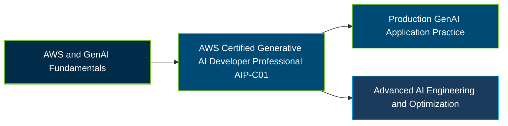

# AWS Certified Generative AI Developer - Professional (AIP-C01) Certification Exam Guide

A dedicated, comprehensive study guide and generative AI reference repository for candidates preparing for the **AWS Certified Generative AI Developer - Professional (AIP-C01) Certification Exam**.

---

## Exam Overview

The AWS Certified Generative AI Developer - Professional certification validates advanced skills in integrating foundation models into applications, implementing generative AI workflows, and deploying secure, production-ready AI solutions on AWS.

- **Exam Format**: Multiple-choice and multiple-response questions; testing center or online proctored exam
- **Target Audience**: Generative AI developers, application engineers, and cloud professionals building production-grade AI applications
- **Prerequisites**: No mandatory prior certification; AWS recommends 2+ years of production application development experience and 1 year of hands-on generative AI implementation experience

---

## Core Exam Domains & Knowledge Areas

### 1. Foundation Model Integration, Data Management, and Compliance

- Integrating foundation models with application data, vector stores, and knowledge bases.
- Implementing retrieval-augmented generation (RAG) and managing data for GenAI solutions.
- Addressing data privacy, compliance, and responsible data handling.

### 2. Implementation and Integration

- Implementing agentic AI solutions, tool integrations, and model deployment strategies.
- Integrating foundation model APIs into applications and business workflows.
- Designing enterprise integration architectures and application development workflows.

### 3. AI Safety, Security, and Governance

- Applying identity, access, and security controls to GenAI applications.
- Implementing content safety, guardrails, and responsible AI practices.
- Addressing governance, privacy, and risk management requirements.

### 4. Operational Efficiency and Optimization for GenAI Applications

- Monitoring and optimizing application performance, reliability, and cost.
- Improving inference efficiency and resource utilization.
- Applying operational practices to maintain production GenAI applications.

### 5. Testing, Validation, and Troubleshooting

- Evaluating foundation model outputs for quality, accuracy, and responsibility.
- Testing GenAI applications and troubleshooting integration failures.
- Monitoring application behavior and resolving performance or reliability issues.

---

## Certification Path

This is a suggested learning progression, not an official prerequisite or mandatory certification sequence.

---

## Recommended Practice & Study Resources

Combine official AWS exam preparation materials with practical exercises in foundation model integration, agentic AI, application testing, security, and optimization.

- **Official AWS Resources**: Review the [AWS Certified Generative AI Developer - Professional page](https://aws.amazon.com/certification/certified-generative-ai-developer-professional/) and the [official AIP-C01 exam guide](https://docs.aws.amazon.com/aws-certification/latest/ai-professional-01/ai-professional-01.html).
- **CertsGate**: Explore [AIP-C01 certification preparation resources](https://certsgate.com/exams/amazon/aip-c01) for supplementary study materials and practice questions.
- **Practical AWS Study**: Use the [Amazon Bedrock documentation](https://docs.aws.amazon.com/bedrock/) to explore foundation model integration, knowledge bases, guardrails, and generative AI application development.
